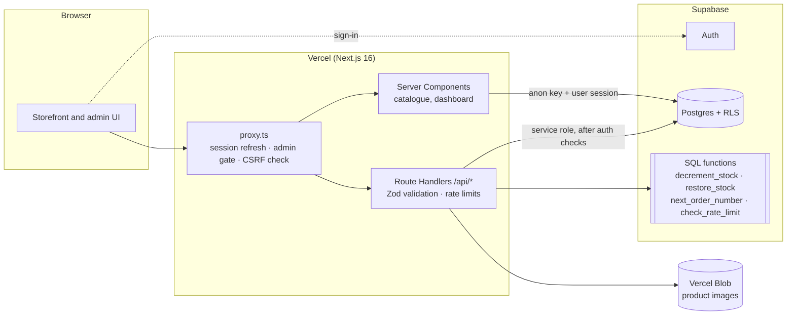

<div align="center">


### E-commerce platform for Flux Dekor: furniture, décor and tools in Kosovo

A storefront and an admin back office in one Next.js app, backed by Supabase.

[](https://github.com/iligashi/MoblieriaDardania/actions/workflows/ci.yml)


**[flux-dekor.com](https://flux-dekor.com)** · [Security policy](SECURITY.md)

</div>

---

## Contents

- [Overview](#overview)
- [Features](#features)
- [Architecture](#architecture)
- [Security](#security)
- [Getting started](#getting-started)
- [Database](#database)
- [Deployment](#deployment)
- [Project structure](#project-structure)
- [Conventions](#conventions)

## Overview

Flux Dekor is a production e-commerce site for a furniture and home-goods retailer in Kosovo. Customers browse a catalogue organised by category, add items to a cart (as guests or signed in), and check out with cash on delivery or bank transfer. Staff run the shop from an admin panel: products, stock, categories and the order pipeline.

The interface is in Albanian. Prices are in euros.

## Features

### Storefront

- **Catalogue:** category cards with product collages, a category bar with subcategories, search, filters (price, colour, material, stock, sale) and sorting.
- **Product pages:** gallery with lightbox, specifications, structured data (JSON-LD) and Open Graph tags.
- **Cart:** slide-over drawer and a full cart page. Guest carts move into the account when the customer signs in.
- **Checkout:** validated form, server-side pricing, free-shipping progress, cash on delivery or bank transfer.
- **Accounts:** registration, sign-in, profile, password change (requires the current password) and order history.
- **Wishlist:** stored in the account, or in the browser for guests.
- **SEO and accessibility:** `sitemap.xml`, `robots.txt`, canonical URLs, a skip link, keyboard navigation and reduced-motion support.

### Admin panel (`/admin`)

- **Dashboard:** 30-day revenue compared with the previous period, order counts, average order value, a revenue chart, top sellers and low-stock alerts.
- **Orders:** status tabs, search, an order detail sheet, a status workflow and a WhatsApp link to the customer.
- **Products:** table with quick toggles (active, featured). The editor has drag-and-drop multi-image upload, cover ordering, custom fields and an unsaved-changes guard.
- **Categories:** two-level tree as cards, with a live storefront preview, colour or photo covers, ordering, visibility, and a warning for products without a category.
- **Settings:** colour and material lists used by the shop filters.

## Architecture



**Design decisions**

- **Two database clients.** Server Components read public data with the anon key and the user's session, so RLS applies. Route Handlers use the service-role key only after confirming that the caller owns the data or is an admin.
- **One set of business rules** (`lib/shop-config.ts`). Shipping, thresholds and price helpers are shared by the UI and the order API, so the price shown is the price charged.
- **Atomic stock.** Stock is reserved in Postgres before an order is written and released if the order fails, so the last item can't be sold twice.
- **Admin access is checked three times:** in `proxy.ts` (redirect), in the admin layout (`requireAdminPage`) and in every admin API route (`requireAdminApi`).

## Security

Every API route validates its input with Zod. Prices are computed on the server. Every table has RLS. The service-role key is server-only (`server-only` guard). Pages ship a strict CSP and HSTS. `proxy.ts` rejects cross-site writes, and checkout, cart, wishlist and uploads are rate-limited. Uploads are checked by file signature.

See **[SECURITY.md](SECURITY.md)** for the full list of controls, the dashboard settings checklist and how to report a vulnerability.

## Getting started

### Prerequisites

- Node.js **20.9+** (22 recommended)
- [pnpm](https://pnpm.io/) 9
- A [Supabase](https://supabase.com/) project
- A [Vercel Blob](https://vercel.com/docs/storage/vercel-blob) store, for image uploads

### 1. Install

```bash
git clone https://github.com/iligashi/MoblieriaDardania.git
cd MoblieriaDardania
pnpm install
```

### 2. Configure the environment

```bash
cp .env.example .env.local
```

| Variable | Where it's used | Description |
|---|---|---|
| `NEXT_PUBLIC_SUPABASE_URL` | browser + server | Supabase project URL |
| `NEXT_PUBLIC_SUPABASE_ANON_KEY` | browser + server | Publishable (anon) key |
| `SUPABASE_SERVICE_ROLE_KEY` | **server only** | Secret key. Never expose it or commit it. |
| `BLOB_READ_WRITE_TOKEN` | server only | Vercel Blob token for uploads |
| `NEXT_PUBLIC_SITE_URL` | build | Canonical URL, e.g. `https://flux-dekor.com` |
| `NEXT_PUBLIC_WHATSAPP_NUMBER` | browser | Optional. Digits only, with country code |

### 3. Set up the database

Run the SQL files in [`scripts/`](scripts) in order, in the Supabase SQL editor. See [Database](#database).

### 4. Create an admin

Admins are never created by sign-up. Create one explicitly:

```bash
ADMIN_EMAIL=you@example.com ADMIN_PASSWORD='a-long-unique-password' pnpm create-admin
```

### 5. Run

```bash
pnpm dev          # http://localhost:3000
```

| Script | Purpose |
|---|---|
| `pnpm dev` | Development server |
| `pnpm build` | Production build |
| `pnpm start` | Serve the production build |
| `pnpm typecheck` | TypeScript, no emit |
| `pnpm create-admin` | Create or promote an admin account |

## Database

| Migration | Purpose |
|---|---|
| `001_create_furniture_table.sql` | Original catalogue table |
| `002_create_admin_trigger.sql` | **Retired.** Kept for history. It made every sign-up an admin and is removed by 008. |
| `004_add_custom_fields.sql` | JSONB custom fields per product |
| `005_create_settings_table.sql` | Colour and material lists |
| `006_create_orders_table.sql` | Order requests |
| `007_transform_to_ecommerce.sql` | Categories, products, customers, addresses, carts, wishlists, order items, banners, RLS |
| `008_security_hardening.sql` | RLS fixes, `is_admin()`, atomic `decrement_stock`, order-number sequence, integrity constraints |
| `009_rate_limits_and_stock.sql` | `check_rate_limit`, `restore_stock`, two-level category guard, category image format |

Every migration from 007 onward is idempotent and safe to re-run.

**Main tables:** `products`, `categories`, `customers`, `addresses`, `cart_items`, `wishlist_items`, `orders`, `order_items`, `settings`, `admin_users` and `rate_limits`.

## Deployment

The site deploys on **Vercel**. Pushes to `main` go to production, and every pull request gets a protected preview.

1. **Run any new migration in Supabase first.** The code expects the schema to be in place.
2. Set the environment variables in Vercel for *Production* and *Preview*.
3. Merge to `main`.

CI (`.github/workflows/ci.yml`) runs a type check, a dependency audit (it fails on high or critical vulnerabilities) and a production build on every push and pull request. Dependabot opens weekly update PRs.

## Project structure

```
app/
├── page.tsx                  Home
├── shop/                     Catalogue with filters and the category bar
├── products/[slug]/          Product page (JSON-LD, Open Graph)
├── cart/  checkout/  wishlist/
├── account/                  Sign-in, register, overview, orders, profile
├── admin/
│   ├── login/                Admin sign-in
│   └── (panel)/              Dashboard, orders, products, categories, settings (one guarded layout)
└── api/                      cart · categories · orders · products · settings · uploads · wishlist
components/
├── admin/                    Admin shell, tables, editors, charts
├── account/                  Account UI
├── providers/                Auth, cart and wishlist context
└── ui/                       Radix-based primitives
lib/
├── auth/admin.ts             requireAdminPage / requireAdminApi
├── catalog.ts                Category tree, counts, safe category filters
├── rate-limit.ts             Database-backed rate limiter
├── shop-config.ts            Business rules shared by the UI and the server
├── supabase/                 Browser, server and service-role clients
└── validation/               Zod schemas and sanitisers
proxy.ts                      Session refresh, admin gate, CSRF check
scripts/                      SQL migrations and the create-admin script
```

## Conventions

- **TypeScript strict.** No `any` in application code paths.
- **Validate at the edge.** Every Route Handler parses its input with a Zod schema from `lib/validation`.
- **Server decides.** Prices, totals, stock and permissions are never trusted from the client.
- **Commits** follow [Conventional Commits](https://www.conventionalcommits.org/) (`feat:`, `fix:`, `chore:`, `docs:`).
- **UI copy** is Albanian with correct diacritics (ë, ç).

---

<sub>© Flux Dekor. All rights reserved. This source is published for transparency and is not licensed for reuse.</sub>
